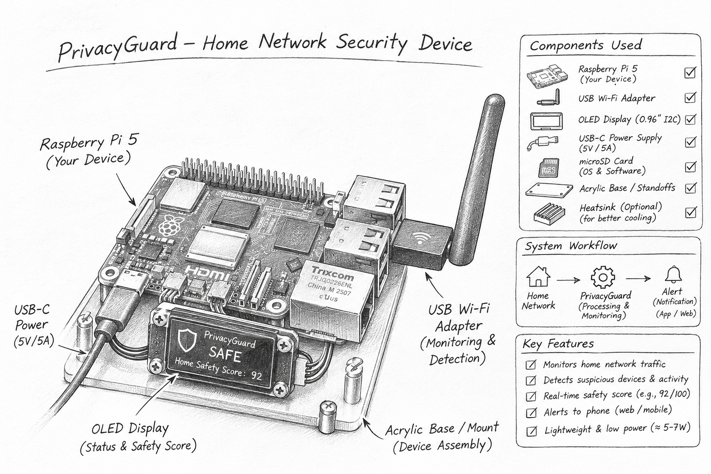
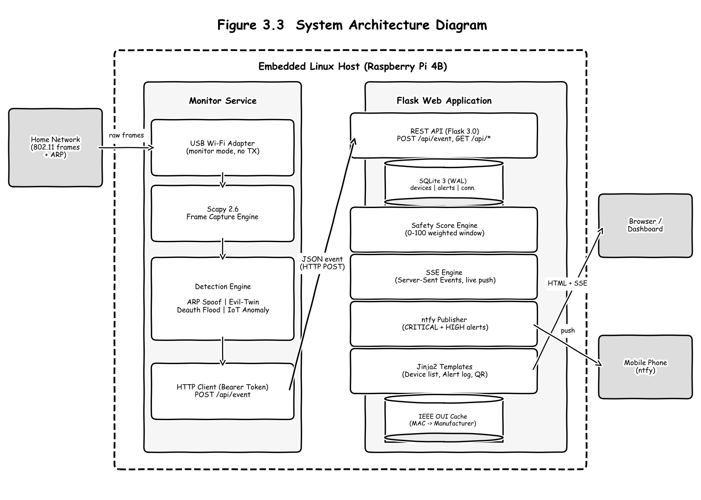
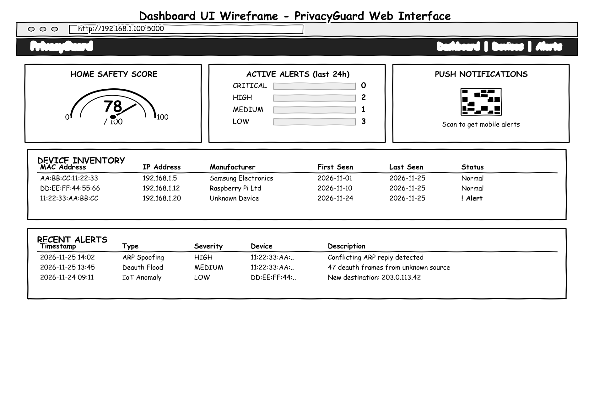

<div align="center">

# PrivacyGuard

### A home wireless threat detection system for everyday households

Catch Wi-Fi attacks and snooping devices on your home network, explained in plain English, with every bit of data staying local on your own device.


</div>

---

## What it looks like

<div align="center">



</div>

PrivacyGuard runs on a Raspberry Pi with a USB Wi-Fi adapter and a small front screen
showing your live Home Safety Score. It sits quietly next to your router, watches your
network 24/7, and buzzes your phone when something is wrong.

---

## Why it exists

The average UK household has nine or more connected devices, and no simple way to know
when one is compromised or when someone is attacking the network. Commercial options are
either closed cloud boxes with subscriptions, or command-line tools built for security
professionals. PrivacyGuard fills the gap: **wireless attack detection with a plain-English
interface, at household cost, with no cloud dependency.**

It is designed with victims of domestic abuse and stalkerware in mind, keeping all
monitoring data on the household's own device rather than a cloud account an abuser could
reach.

---

## What it detects

| Threat | How it is detected | Severity |
|---|---|---|
| **ARP spoofing** | An ARP reply claims an IP already mapped to a different MAC | HIGH |
| **Evil-twin access point** | A beacon broadcasts your network name from an unknown router | CRITICAL |
| **Deauthentication flood** | A burst of deauth frames from one source inside a time window | MEDIUM |
| **IoT anomaly** | A device contacts a destination outside its learned baseline | LOW / MEDIUM |

It can flag a hidden Wi-Fi camera or bug that joins your network (it shows up as an unknown
device with anomalous outbound traffic). It cannot see devices that avoid your network
entirely, such as cameras that record to a local card or bugs on a cellular connection.

---

## How it works

<div align="center">



</div>

Two services run on a single Raspberry Pi:

1. **Monitor service** captures 802.11 and ARP frames passively (the USB adapter in monitor
   mode), runs each frame through the detection engine, and sends threat events to the API.
2. **Flask web app** stores events in SQLite, serves a live dashboard over Server-Sent
   Events, computes the Home Safety Score, and pushes phone alerts via ntfy.

Both run under systemd with automatic restart, so the device monitors around the clock with
no daily effort.

### The dashboard

<div align="center">



</div>

---

## Project status

Built in phases, each testable without the physical adapter until the final step.

| Phase | Scope | Status |
|---|---|---|
| 1 | Detection engine (4 rules, fully unit-tested) | **Done** |
| 2 | SQLite persistence + Flask REST API + Safety Score | Planned |
| 3 | Live dashboard (SSE), device inventory, OUI lookup | Planned |
| 4 | ntfy push notifications + OLED display | Planned |
| 5 | Live Scapy capture + systemd deployment | Needs hardware |

The detection engine is complete with **13 tests and 100% coverage**. See
[`docs/BUILD_PLAN.md`](docs/BUILD_PLAN.md) for the full plan.

---

## Getting started (development)

No hardware is required to run the detection engine and its tests.

```bash
# clone and enter
git clone <your-repo-url> privacyguard
cd privacyguard

# install
python -m venv .venv
.venv\Scripts\activate        # Windows
# source .venv/bin/activate   # Linux / macOS
pip install -r requirements.txt

# run the test suite
pytest -q

# run with coverage on the detection engine
pytest --cov=privacyguard.monitor.detection --cov-report=term-missing
```

---

## Tech stack

| Layer | Technology |
|---|---|
| Capture | Scapy 2.6 (802.11 + ARP, monitor mode) |
| Detection | Pure Python rules on decoupled frame objects |
| Backend | Flask 3.0 REST API |
| Storage | SQLite 3 (WAL mode), fully local |
| Dashboard | Jinja2 + Server-Sent Events |
| Notifications | ntfy (phone push, no app account) |
| Display | 1.3" I2C OLED (live Safety Score) |
| Testing | pytest + coverage |
| Platform | Raspberry Pi 5, Raspberry Pi OS |

---

## Repository structure

```
privacyguard/
  monitor/      capture (Scapy) + detection engine + frame models
  web/          Flask API, SQLite schema, dashboard
  display/      OLED rendering
tests/          pytest suite (hardware-free)
systemd/        service units for 24/7 operation
docs/           build plan + diagrams
```

---

## Hardware

- Raspberry Pi 5
- USB Wi-Fi adapter with monitor mode (e.g. Alfa AWUS036ACH)
- microSD card (32GB), USB-C power (5V / 5A)
- Optional: 1.3" I2C OLED display, acrylic base, heatsink

---

## License

MIT. See [`LICENSE`](LICENSE).

---

<div align="center">

Built by **Tanvir Farhad** as a final-year Computing project at Ulster University.

</div>
